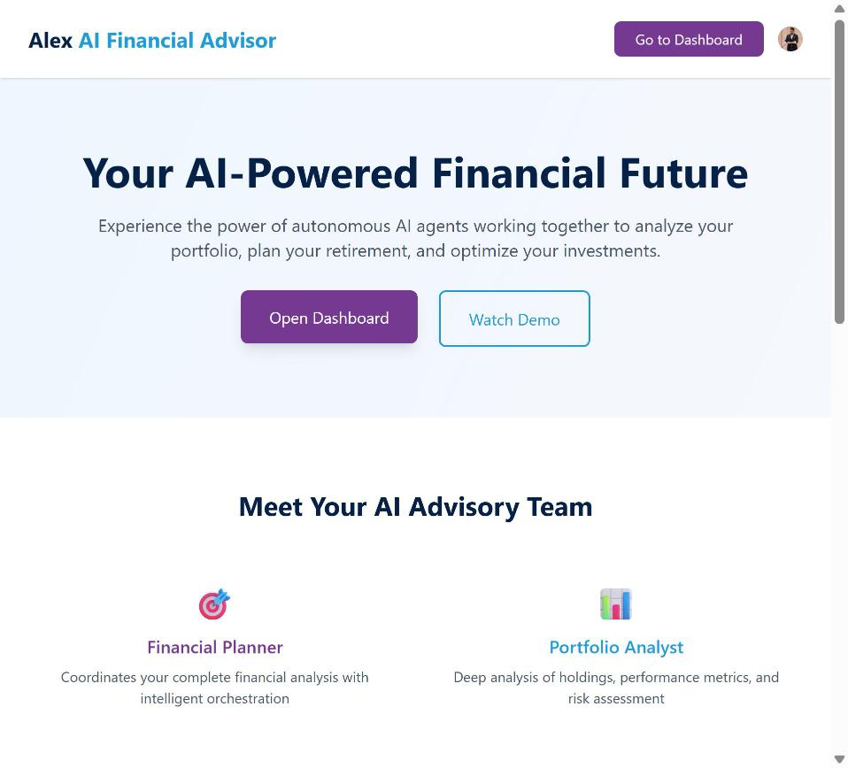
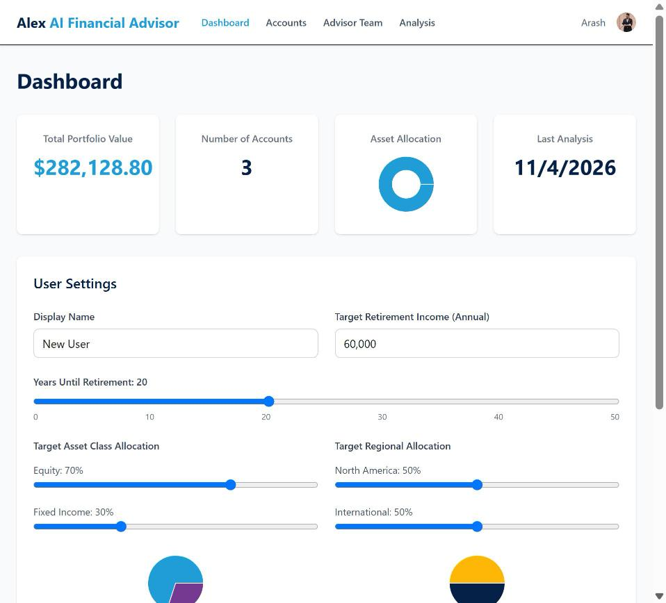
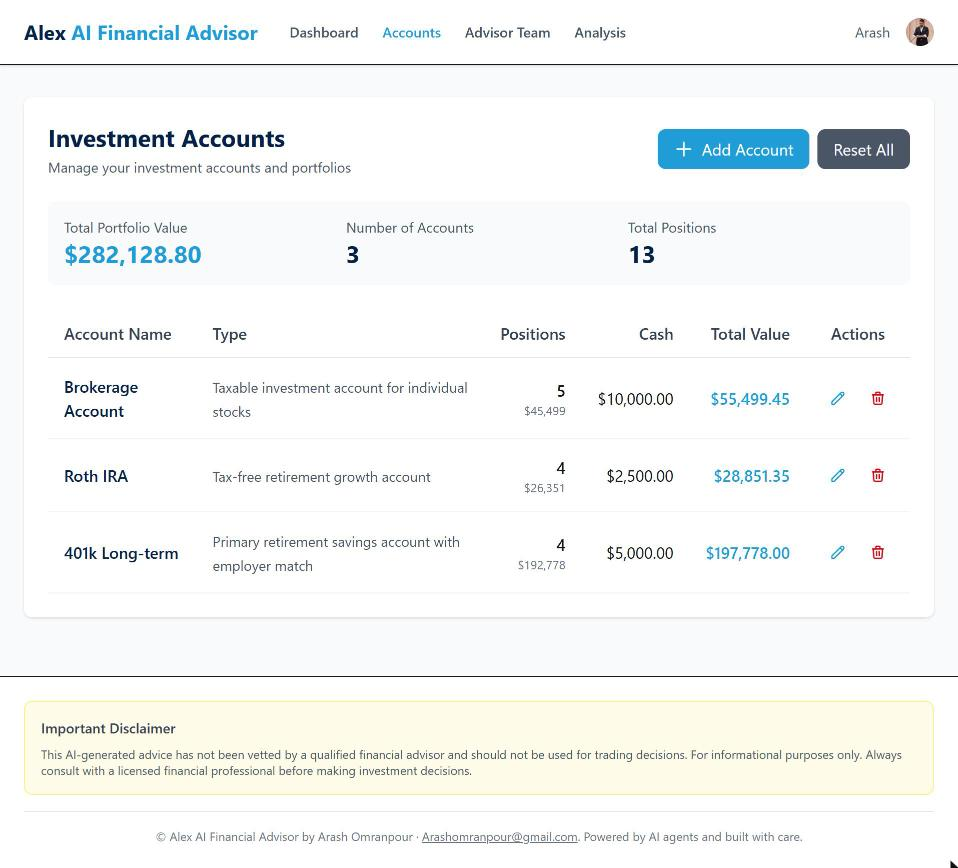
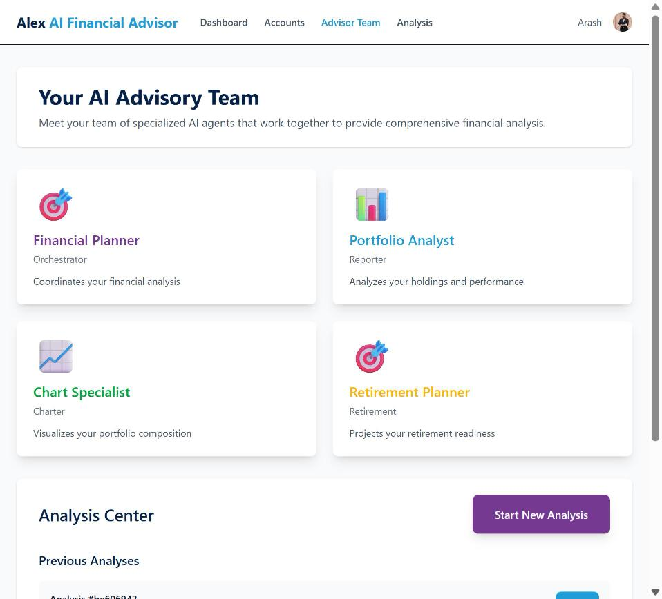
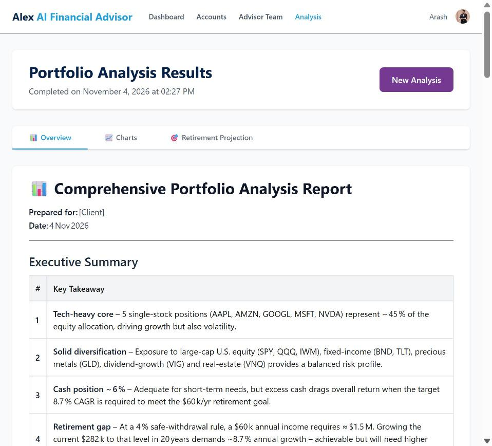
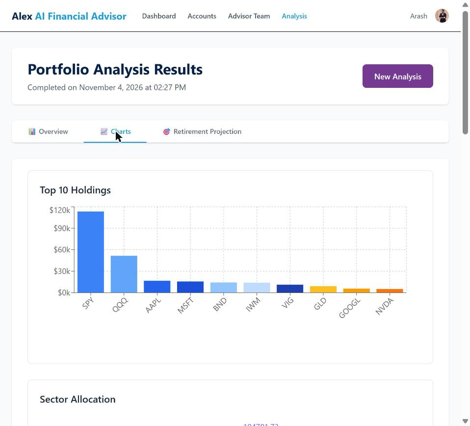
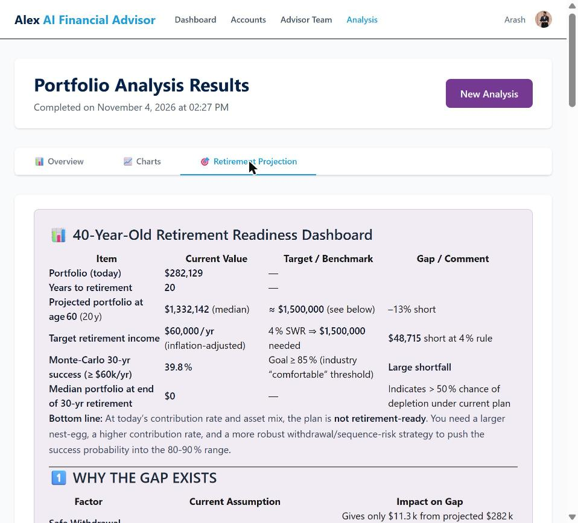
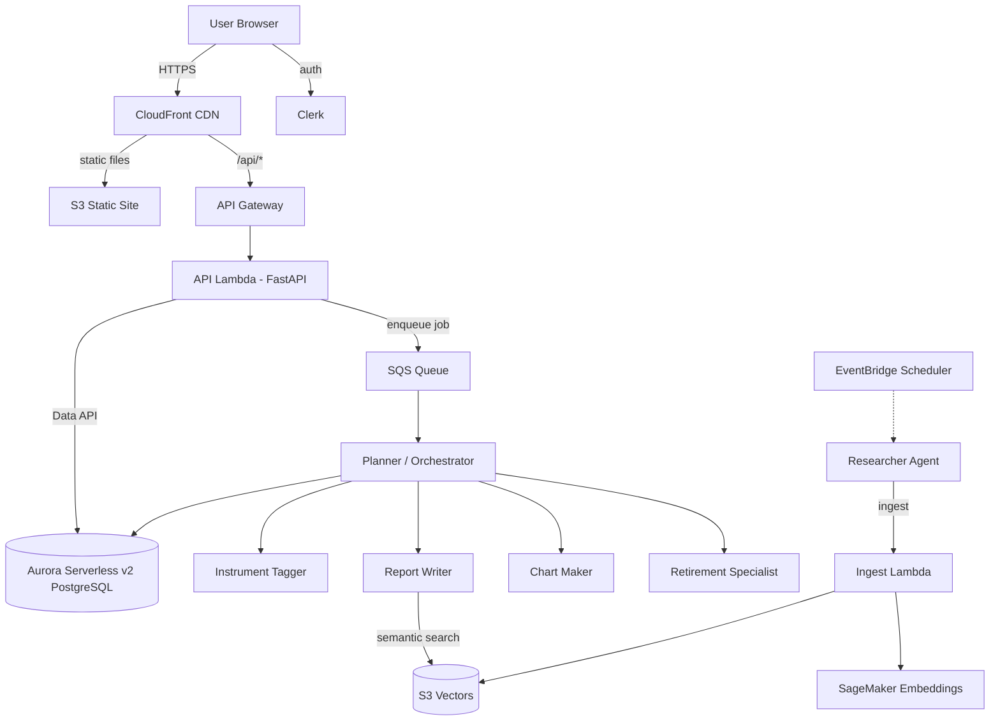

# Alex — AI Financial Planner


[](https://github.com/Arashomranpour/alex-financial-planner/actions/workflows/ci.yml)
[](https://github.com/Arashomranpour/alex-financial-planner/actions/workflows/deploy-frontend.yml)
[](https://github.com/Arashomranpour/alex-financial-planner/actions/workflows/deploy-backend.yml)

**Alex** (Agentic Learning Equities eXplainer) is a multi-agent SaaS financial planner that runs entirely on AWS serverless infrastructure. Users sign in, enter their investment accounts and holdings, and a team of AI agents works together to analyze the portfolio. The result is a written report, interactive charts, and a retirement projection.

**Live demo:** https://d141bdvqlfevns.cloudfront.net

## Screenshots

| Landing page | Dashboard |
|---|---|
|  |  |
| **Accounts** | **AI advisory team** |
|  |  |
| **Analysis report** | **Portfolio charts** |
|  |  |
| **Retirement projection** | |
|  | |

## Features

- **Portfolio management**: create accounts (401k, IRA, taxable…), add positions, and track cash balances.
- **Multi-agent analysis**: a planner agent orchestrates specialist agents that run in parallel.
- **Interactive results**: a markdown report, allocation, sector and geography charts, and Monte Carlo retirement projections.
- **Market research**: an autonomous researcher agent browses the web and stores insights in a vector knowledge base.
- **Authentication**: Clerk sign-in, with JWT validation on every API call.
- **Fully serverless**: Lambda, Aurora Serverless v2, SQS, S3 Vectors, CloudFront. You pay almost nothing when it's idle.

## Architecture



### The agents

| Agent | Role |
|-------|------|
| **Planner** | Orchestrator. It receives jobs from SQS, gathers portfolio data, fills in missing instrument data, and invokes the specialists. |
| **Tagger** | Classifies instruments (asset class, region, sector) with structured outputs. |
| **Reporter** | Writes the portfolio analysis report, using the vector knowledge base for market context. An LLM judge scores the output. |
| **Charter** | Produces chart data for allocation, sectors, geography and top holdings. |
| **Retirement** | Runs Monte Carlo simulations and retirement-readiness projections. |
| **Researcher** | Browses the web for market research and ingests findings into S3 Vectors. It can run on a schedule. |

The agents are built with the OpenAI Agents SDK and call models through **LiteLLM**. That means they can run on **Groq** (default: `groq/openai/gpt-oss-120b`) or **Amazon Bedrock** (for example, Nova Pro), switched with one environment variable.

## Tech stack

| Layer | Technology |
|-------|------------|
| Frontend | Next.js (React, TypeScript), Tailwind CSS, Recharts, Clerk |
| API | FastAPI on AWS Lambda behind API Gateway |
| Agents | OpenAI Agents SDK + LiteLLM (Groq / Bedrock), AWS Lambda, SQS |
| Data | Aurora Serverless v2 PostgreSQL (RDS Data API), Pydantic schemas |
| Knowledge base | S3 Vectors + SageMaker Serverless embeddings |
| Infrastructure | Terraform (one independent module per part), Docker for Lambda packaging |
| Observability | CloudWatch, optional LangFuse tracing |

## Repository layout

```
backend/          Python uv projects (one per service)
  api/            FastAPI backend for the frontend
  planner/        Orchestrator agent
  tagger/         Instrument classification agent
  reporter/       Report writer agent (+ LLM judge)
  charter/        Chart data agent
  retirement/     Retirement projection agent
  researcher/     Web research agent (container on Lambda)
  ingest/         Document ingestion + vector search Lambdas
  scheduler/      EventBridge trigger for the researcher
  database/       Shared DB client, Pydantic schemas, migrations, seed data
frontend/         Next.js app (static export, served from S3 + CloudFront)
terraform/        Independent Terraform modules, deployed in order
  2_sagemaker/    Embedding endpoint
  3_ingestion/    S3 Vectors + ingest Lambda + API Gateway
  4_researcher/   Researcher container (ECR + Lambda) + scheduler
  5_database/     Aurora Serverless v2 + Secrets Manager
  6_agents/       Agent Lambdas + SQS queue
  7_frontend/     S3 site, CloudFront, API Gateway, API Lambda
  8_enterprise/   Monitoring dashboards and alarms
  9_cicd/         GitHub Actions OIDC deploy role
scripts/          Local dev runner, deploy and destroy scripts
.github/workflows CI checks + automatic deploys
```

## Getting started

### Prerequisites

- An AWS account with the AWS CLI configured
- Terraform ≥ 1.5, Docker, Node.js 20+, Python 3.12 with [uv](https://docs.astral.sh/uv/)
- A [Clerk](https://clerk.com) application (the free tier is fine)
- A [Groq](https://console.groq.com) API key, or Bedrock model access
- A [Polygon.io](https://polygon.io) API key (the free plan works) for market prices

### Configuration

Copy the example files and fill in your own values. They are all gitignored, so never commit real keys.

```bash
cp .env.example .env                        # backend settings + API keys
cp terraform/<module>/terraform.tfvars.example terraform/<module>/terraform.tfvars
```

The frontend needs `frontend/.env.local`:

```bash
NEXT_PUBLIC_CLERK_PUBLISHABLE_KEY=pk_test_...
CLERK_SECRET_KEY=sk_test_...
NEXT_PUBLIC_CLERK_AFTER_SIGN_IN_URL=/dashboard
NEXT_PUBLIC_CLERK_AFTER_SIGN_UP_URL=/dashboard
NEXT_PUBLIC_API_URL=http://localhost:8000
```

### Deploy

Each Terraform module has its own state. Deploy them in order and copy each module's outputs into `.env` and the next module's `terraform.tfvars`:

```bash
# 1. Embeddings, ingestion, researcher
cd terraform/2_sagemaker  && terraform init && terraform apply
cd ../3_ingestion         && terraform init && terraform apply
cd ../../backend/researcher && uv run deploy.py

# 2. Database: create the schema and load seed data
cd ../../terraform/5_database && terraform init && terraform apply
cd ../../backend/database && uv run run_migrations.py && uv run seed_data.py

# 3. Agents: package with Docker, then deploy
cd .. && uv run package_docker.py
cd ../terraform/6_agents && terraform init && terraform apply

# 4. API + frontend
cd ../../backend/api && uv run package_docker.py
cd ../../terraform/7_frontend && terraform init && terraform apply
cd ../../scripts && uv run deploy.py        # builds the frontend, uploads to S3, invalidates CloudFront
```

`terraform output cloudfront_url` in `terraform/7_frontend` gives you the live app URL.

> **AWS free-plan accounts** can't create a standard Aurora cluster. Instead, create an Aurora PostgreSQL cluster with *express configuration*, enable the Data API, and create a database user with a password stored in Secrets Manager. Then put that cluster ARN and secret ARN in `.env` and `terraform/6_agents/terraform.tfvars`.

### Run locally

```bash
cd frontend && npm install
cd ../scripts && uv run run_local.py
```

- Frontend: http://localhost:3000
- API: http://localhost:8000 (Swagger docs at `/docs`)

Portfolio management works locally. AI analysis needs the AWS agents deployed.

## CI/CD

GitHub Actions authenticates to AWS through **OIDC**: a short-lived role session, with no AWS keys stored in GitHub.

| Workflow | Trigger | What it does |
|----------|---------|--------------|
| `ci.yml` | every push and PR | Builds the frontend, compiles all Python, validates every Terraform module |
| `deploy-frontend.yml` | push to `main` touching `frontend/**` | Builds the static site, syncs it to S3, invalidates CloudFront |
| `deploy-backend.yml` | push to `main` touching the API, database or agent code | Packages the Lambdas with Docker, uploads them to S3, updates `alex-api` and the 5 agent functions |

One-time setup:

```bash
cd terraform/9_cicd
cp terraform.tfvars.example terraform.tfvars   # set github_repository + cloudfront_distribution_id
terraform init && terraform apply              # outputs github_deploy_role_arn
```

Then add these **repository variables** (Settings → Secrets and variables → Actions → Variables): `AWS_ROLE_ARN`, `AWS_REGION`, `FRONTEND_BUCKET`, `CLOUDFRONT_DISTRIBUTION_ID`, `LAMBDA_PACKAGES_BUCKET`, `API_URL`, `CLERK_PUBLISHABLE_KEY`. None of these is a secret: the Clerk publishable key is public by design. Until `AWS_ROLE_ARN` is set, the deploy workflows are skipped.

### Tear down

```bash
cd scripts && uv run destroy.py   # or run `terraform destroy` in each module, in reverse order
```

Aurora is the main ongoing cost. Destroy it, or let express clusters scale to zero, when you aren't using the app.

## Security notes

- Secrets live only in gitignored `.env`, `.env.local` and `terraform.tfvars` files, and in AWS Secrets Manager.
- Every API request is authenticated with a Clerk JWT, validated against your Clerk JWKS endpoint.
- The database is reached over the IAM-authenticated RDS Data API. It is never publicly exposed.

## Author

**Arash Omranpour**: [Arashomranpour@gmail.com](mailto:Arashomranpour@gmail.com) · [GitHub](https://github.com/Arashomranpour)

## Acknowledgements

This version runs the agents on Groq through LiteLLM, supports AWS free-plan accounts with Aurora express configuration, retries while a paused database resumes, and adds CI/CD with GitHub Actions.
I Love Claude .
## License

MIT © 2026 Arash Omranpour. See [LICENSE](LICENSE).
